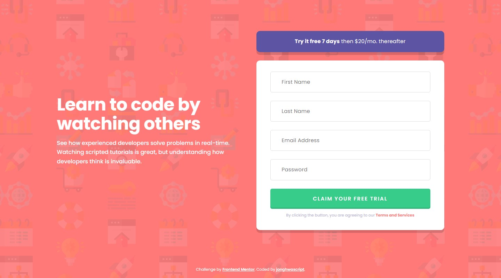

# Frontend Mentor - Intro component with sign up form solution

This is a solution to the [Intro component with sign up form challenge on Frontend Mentor](https://www.frontendmentor.io/challenges/intro-component-with-signup-form-5cf91bd49edda32581d28fd1). Frontend Mentor challenges help you improve your coding skills by building realistic projects.

## Table of contents

- [Overview](#overview)
  - [The challenge](#the-challenge)
  - [Screenshot](#screenshot)
  - [Links](#links)
- [My process](#my-process)
  - [Built with](#built-with)
  - [What I learned](#what-i-learned)
  - [Continued development](#continued-development)
  - [Useful resources](#useful-resources)
  - [AI Collaboration](#ai-collaboration)
- [Author](#author)

## Overview

### The challenge

Users are able to:

- View the optimal layout for the site depending on their device's screen size
  (one column below 1024px, two columns from 1024px up)
- See hover and focus states for all interactive elements on the page
- Receive an error message when the `form` is submitted if:
  - Any `input` field is empty. The message says *"[Field Name] cannot be empty"*
  - The email address is not formatted correctly (`name@host.tld`). The message
    says *"Looks like this is not an email"*

### Screenshot



### Links

- Challenge URL: [Frontend Mentor challenge](https://www.frontendmentor.io/challenges/intro-component-with-signup-form-5cf91bd49edda32581d28fd1)
- Solution URL: [Repository](https://github.com/jonghwascript/intro-component-with-signup-form)
- Live Site URL: [Live site](https://jonghwascript.github.io/intro-component-with-signup-form/)

## My process

### Built with

- Semantic HTML5 markup (`main`, `section` landmarks, one `h1`)
- CSS custom properties as design tokens (colors, spacing, type presets)
- Flexbox and CSS Grid
- Mobile-first workflow
- Vanilla JavaScript, no dependencies
- [`node:test`](https://nodejs.org/api/test.html) - unit tests for the
  validation logic, with zero installed packages
- [GitHub Actions](https://docs.github.com/actions) - deploys only the site
  files to GitHub Pages on every push to `main`
- [Spec Kit](https://github.com/github/spec-kit) - spec, plan and task docs
  under [`specs/`](./specs/001-intro-signup-form)

### What I learned

- **Keep validation pure so it can be tested without a browser.**
  `js/validation.js` never touches the DOM. It exports through CommonJS when
  `module` exists (Node tests) and through `window.SignupValidation`
  otherwise, so the same file runs in both places without a build step.

  ```js
  if (typeof module !== 'undefined' && module.exports) {
    module.exports = api;
  } else {
    root.SignupValidation = api;
  }
  ```

- **An error message has to be wired to its input, not just placed next to
  it.** On each submit, every field is re-rendered: invalid ones get
  `aria-invalid="true"` and `aria-describedby` pointing at their message, and
  focus moves to the first invalid field.

  ```js
  input.setAttribute('aria-invalid', 'true');
  input.setAttribute('aria-describedby', errorEl.id);
  ```

- **The error styling can hang off the ARIA state.** Using
  `[aria-invalid="true"]` as the CSS hook means the visual state and what a
  screen reader hears can never drift apart.

  ```css
  .field__input[aria-invalid="true"] {
    border: 2px solid var(--color-red-400);
    background-image: url("../images/icon-error.svg");
  }
  ```

- **A screen-reader summary doesn't have to change the design.** The mockup
  shows no error summary or success message, so a visually hidden
  `role="status"` live region announces the error count and each message, or a
  success message after a valid submit. Because it is invisible, it holds
  plain text only: a link inside it would take focus where nobody can see it.

- **Checking against a checklist finds things testing by eye misses.** Going
  through [The A11Y Project checklist](https://www.a11yproject.com/checklist/)
  turned up missing success feedback and several colour contrast failures
  that looked fine on screen.

### Continued development

- **Colour contrast.** Several design colours fail WCAG AA: white text on the
  red background (2.54:1), white text on the green button (2.06:1), the terms
  text (1.94:1) and the input border (1.35:1). Fixing them means darker shades
  than the mockup, so it is a design decision still to make.
- **Visible labels.** Labels are visually hidden and the placeholder acts as
  the label, so a field shows no name once it has a value. Visible labels
  would fix this but also change the design.
- **Terms link.** "Terms and Services" still points to `#` because there is no
  real page to link to.

### Useful resources

- [The A11Y Project - Checklist](https://www.a11yproject.com/checklist/) - The
  checklist I used to audit the page.
- [WCAG 2.2 Understanding docs](https://www.w3.org/WAI/WCAG22/Understanding/) -
  For what each success criterion actually requires.
- [MDN - ARIA live regions](https://developer.mozilla.org/en-US/docs/Web/Accessibility/ARIA/ARIA_Live_Regions) -
  How `role="status"` and `aria-live` are announced.
- [GitHub Pages - Using custom workflows](https://docs.github.com/pages/getting-started-with-github-pages/using-custom-workflows-with-github-pages) -
  Deploying with GitHub Actions instead of a branch.

### AI Collaboration

I worked with [Claude Code](https://claude.com/claude-code) during this
project. It helped me:

- Set up the GitHub Pages deployment workflow
- Split the work into Conventional Commits
- Audit the page against The A11Y Project checklist and add the
  screen-reader status messages
- Check the repository for sensitive information before publishing

I reviewed each change. One change got rolled back: the first accessibility
fix showed a visible error summary, which no longer matched the design, so the
summary was made visible only to screen readers.

## Author

- GitHub - [@jonghwascript](https://github.com/jonghwascript)
- Frontend Mentor - [@jonghwascript](https://www.frontendmentor.io/profile/jonghwascript)
